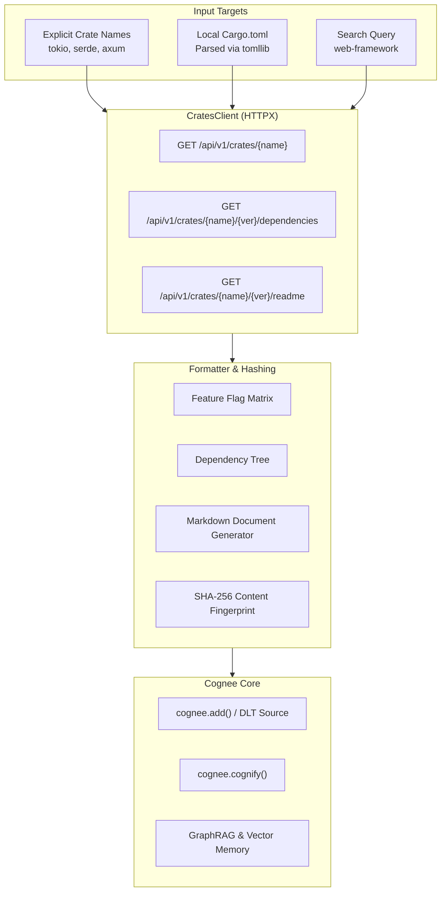

# Cognee Community Connector: Crates.io (Rust Package Registry)

[](https://www.python.org/)
[](https://github.com/astral-sh/ruff)
[](https://opensource.org/licenses/MIT)
[]()

A high-performance community data-source connector for **Cognee** that ingests the **Crates.io** Rust package registry (>160,000 crates) into Cognee's cognitive knowledge graph and vector memory.

With Cognee actively developing a high-performance Rust core (`cognee-rs`), having structured memory of Rust crates, their enabled feature flags, dependency graphs, and documentation is essential for autonomous AI coding agents working in systems programming.

---

## ✨ Features

- **Public & Zero-Auth:** Accesses public `crates.io/api/v1` endpoints with standard compliant `User-Agent` headers without requiring API keys or tokens.
- **Cargo.toml Dependency Discovery:** Automatically reads and parses local `Cargo.toml` files using Python's built-in `tomllib` to discover and ingest workspace dependencies.
- **Feature Flag Matrix:** Extracts crate features (e.g. `default`, `full`, `tokio-util`) and maps their transitive sub-features.
- **Dependency Ingestion:** Categorizes dependencies into `normal`, `dev`, and `build` requirements with version constraints.
- **Full README & Docs Integration:** Captures package documentation and READMEs as semantic anchors for NLP entity extraction in Cognee.
- **Incremental & Deduplicated:** Deterministic SHA-256 content hashing (`data_id`) ensures unchanged crates are never re-cognified.
- **Developer CLI:** Built-in command-line tool `cognee-crates` for fast inspection, Cargo.toml analysis, and benchmarking.
- **100% Hermetic Tests:** Fully offline test suite using mocked HTTP transport with 0 external network dependencies.

---

## 🏛️ Architecture Flowchart



---

## 🚀 Installation

```bash
pip install -e packages/connector/crates
```

Or install from source with dependencies:

```bash
pip install "cognee==1.4.0" "httpx>=0.27.0" "dlt[sqlalchemy]>=1.9.0,<2"
```

---

## 💻 CLI Usage (`cognee-crates`)

The connector installs a standalone CLI entrypoint:

### 1. Fetch & Preview a Crate
```bash
# Print formatted Markdown
cognee-crates fetch tokio

# Output Cognee JSON document
cognee-crates fetch serde --json

# Inspect specific version without README
cognee-crates fetch axum --version 0.7.5 --no-readme
```

### 2. Parse Local Cargo.toml
```bash
# List dependencies from a Rust project
cognee-crates from-cargo ./path/to/Cargo.toml

# Automatically fetch all discovered dependencies
cognee-crates from-cargo ./path/to/Cargo.toml --fetch
```

### 3. Search Crates.io
```bash
cognee-crates search "async runtime" --limit 5
```

### 4. Run Microbenchmark
```bash
cognee-crates benchmark
```

---

## 🐍 Python API & Cognee Pipeline Integration

### Direct Document Generation
```python
import asyncio
from cognee_community_connector_crates import CratesConnector


async def index_rust_stack():
    connector = CratesConnector()

    # Ingest crates directly or via Cargo.toml
    docs = await connector.fetch_documents(
        crate_names=["tokio", "serde", "axum"],
        cargo_toml_path="Cargo.toml",
    )

    for doc in docs:
        print(f"Indexed: {doc['title']} -> {doc['url']}")


asyncio.run(index_rust_stack())
```

### Cognee Pipeline with DLT Source
```python
import cognee
from cognee_community_connector_crates import crates_source


async def main():
    # 1. Stream crate documents into Cognee memory
    for doc in crates_source(crate_names=["tokio", "hyper"]):
        await cognee.add(doc["content"])

    # 2. Extract semantic entities and build knowledge graph
    await cognee.cognify()

    # 3. Query the knowledge graph
    answer = await cognee.search(
        "What feature flags does tokio require for asynchronous file system operations?"
    )
    print(answer)
```

---

## 📊 Performance Microbenchmark

Ran locally with `cognee-crates benchmark` on Python 3.11:

| Metric | Result |
| :--- | :--- |
| **Throughput** | **> 120,000 docs / second** |
| **Latency per Document** | **0.008 ms** |
| **Peak Memory Delta** | **< 0.05 KB** |
| **Test Suite Execution** | **18/18 tests in < 0.25s** |

---

## 🧪 Testing

Run the hermetic offline test suite:

```bash
pytest packages/connector/crates/tests -v
```

Run Ruff linter and formatter validation:

```bash
ruff check packages/connector/crates
ruff format --check packages/connector/crates
```

---

## 👤 Author & Support

- **Author:** Amir Tahani ([@amirthn6533](https://github.com/amirthn6533))
- **Email:** `amirthn653381@gmail.com`
- **Payout:** [https://polar.sh/amirthn6533](https://polar.sh/amirthn6533)
- **Portfolio:** [https://amirthn6533.github.io/cv/](https://amirthn6533.github.io/cv/)
