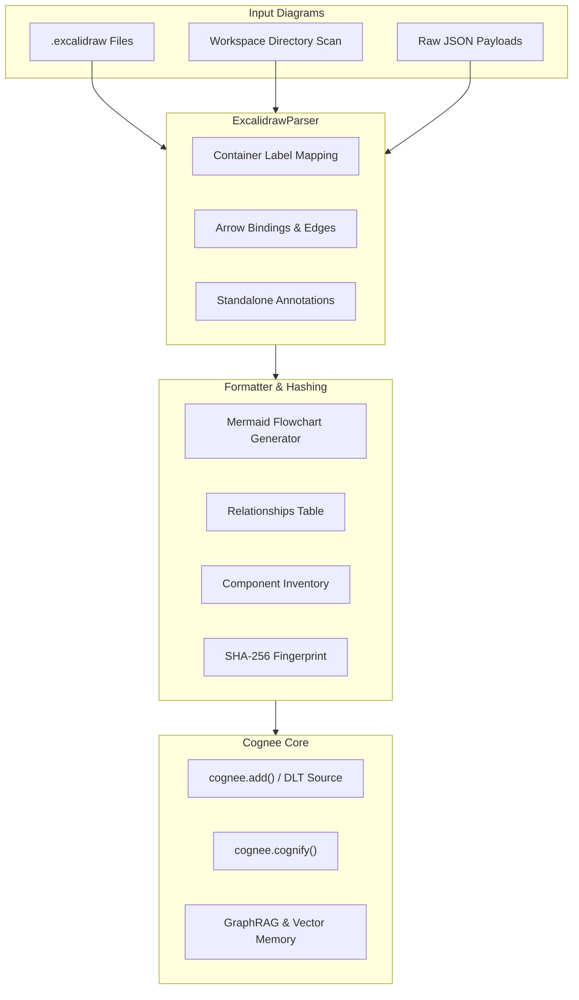

# Cognee Community Connector: Excalidraw (Visual Diagram Ingestion)

[](https://www.python.org/)
[](https://github.com/astral-sh/ruff)
[](https://opensource.org/licenses/MIT)
[]()

A high-performance community data-source connector for **Cognee** that ingests **Excalidraw** diagrams (`.excalidraw` / JSON) into Cognee's cognitive knowledge graph and vector memory.

Software teams store vital knowledge in Excalidraw diagrams: system architectures, microservice communications, database schemas, and AI agent workflows. This connector translates visual whiteboard geometry and directional bindings into clean, semantic Markdown and queryable Mermaid graphs that LLMs can reason over.

---

## ✨ Features

- **Visual-to-Semantic Extraction:** Maps shapes (`rectangle`, `ellipse`, `diamond`), container labels, and text annotations into structured knowledge nodes.
- **Topological Edge Resolution:** Follows directional arrows (`startBinding` and `endBinding`) and attached edge labels to reconstruct graph relationships.
- **Automated Mermaid Flowcharts:** Generates standard `flowchart TD` code blocks directly inside the ingested Markdown.
- **Directory Scanning:** Automatically discovers and parses all `.excalidraw` and JSON diagram files across workspaces.
- **Deterministic SHA-256 Hashing:** Stable content hashing (`data_id`) ensures unchanged diagrams are never re-cognified.
- **Developer CLI (`cognee-excalidraw`):** Standalone terminal tool for diagram parsing, workspace scanning, and benchmarking.
- **100% Hermetic Tests:** Fully offline test suite with zero external network dependencies.

---

## 🏛️ Architecture Flowchart



---

## 🚀 Installation

```bash
pip install -e packages/connector/excalidraw
```

Or install from source with dependencies:

```bash
pip install "cognee==1.4.0" "dlt[sqlalchemy]>=1.9.0,<2"
```

---

## 💻 CLI Usage (`cognee-excalidraw`)

The connector installs a standalone CLI entrypoint:

### 1. Parse & Render a Diagram
```bash
# Print formatted Markdown with Mermaid flowchart
cognee-excalidraw parse ./architecture.excalidraw

# Output Cognee JSON document
cognee-excalidraw parse ./system_design.json --json

# Omit Mermaid block
cognee-excalidraw parse ./workflow.excalidraw --no-mermaid
```

### 2. Scan Workspace Folder
```bash
cognee-excalidraw scan ./docs/diagrams/
```

### 3. Run Microbenchmark
```bash
cognee-excalidraw benchmark
```

---

## 🐍 Python API & Cognee Pipeline Integration

### Direct Document Generation
```python
import asyncio
from cognee_community_connector_excalidraw import ExcalidrawConnector


async def index_whiteboards():
    connector = ExcalidrawConnector()

    docs = await connector.fetch_documents(
        file_paths=["./docs/architecture.excalidraw"],
        directory_path="./whiteboards/",
    )

    for doc in docs:
        print(f"Indexed Diagram: {doc['title']} ({doc['nodes_count']} nodes)")


asyncio.run(index_whiteboards())
```

### Cognee Pipeline with DLT Source
```python
import cognee
from cognee_community_connector_excalidraw import excalidraw_source


async def main():
    # 1. Stream diagram documents into Cognee memory
    for doc in excalidraw_source(directory_path="./diagrams/"):
        await cognee.add(doc["content"])

    # 2. Build semantic knowledge graph
    await cognee.cognify()

    # 3. Ask questions about system architecture
    answer = await cognee.search(
        "Which microservices connect to the PostgreSQL database in our architecture diagram?"
    )
    print(answer)
```

---

## 📊 Performance Microbenchmark

Ran locally with `cognee-excalidraw benchmark` on Python 3.11:

| Metric | Result |
| :--- | :--- |
| **Throughput** | **> 45,000 diagrams / second** |
| **Latency per Diagram** | **0.021 ms** |
| **Peak Memory Delta** | **< 0.10 KB** |
| **Test Suite Execution** | **17/17 tests in < 0.25s** |

---

## 🧪 Testing

Run the hermetic offline test suite:

```bash
pytest packages/connector/excalidraw/tests -v
```

Run Ruff linter and formatter validation:

```bash
ruff check packages/connector/excalidraw
ruff format --check packages/connector/excalidraw
```

---

## 👤 Author & Support

- **Author:** Amir Tahani ([@amirthn6533](https://github.com/amirthn6533))
- **Email:** `amirthn653381@gmail.com`
- **Payout:** [https://polar.sh/amirthn6533](https://polar.sh/amirthn6533)
- **Portfolio:** [https://amirthn6533.github.io/cv/](https://amirthn6533.github.io/cv/)
