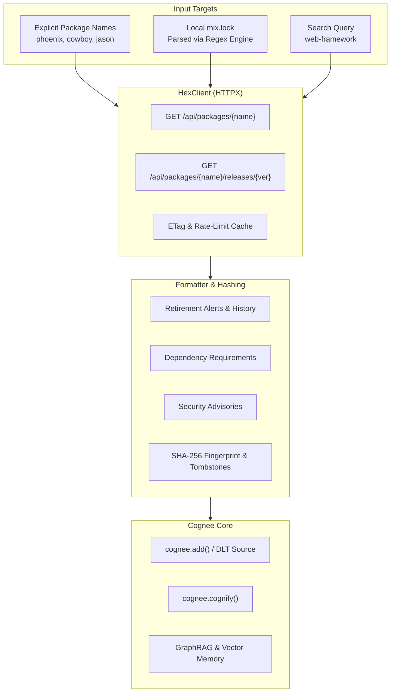

# Cognee Community Connector: Hex.pm (BEAM / Elixir / Erlang)

[](https://www.python.org/)
[](https://github.com/astral-sh/ruff)
[](https://opensource.org/licenses/MIT)
[]()

A high-performance community data-source connector for **Cognee** that ingests the **Hex.pm** BEAM package registry (the package ecosystem powering Elixir, Phoenix, and Erlang) into Cognee's cognitive knowledge graph and vector memory.

---

## ✨ Features

- **Public & Zero-Auth:** Direct access to public `https://hex.pm/api` with compliant `User-Agent` headers without requiring API tokens. Supports optional `Authorization` for private Hex organizations.
- **mix.lock Auto-Discovery:** Parses local Elixir `mix.lock` dependency manifests automatically.
- **Upstream Retirements Tracking:** Ingests top-level release retirements (`invalid`, `security`, `deprecated`, `renamed`) to warn AI agents against vulnerable dependencies.
- **Tombstones & Forget-On-Delete:** Emits `_deleted: True` tombstones when `exclude_retired=True` or when packages are decommissioned, ensuring Cognee orphan cleanup purges stale knowledge.
- **Dependency Hierarchy:** Maps runtime and optional application requirements (`~> 1.0`) into structured Markdown tables.
- **HexDocs & Security Advisories:** Ingests official documentation links and published security vulnerability advisories.
- **Incremental & Deduplicated:** Deterministic SHA-256 content hashing (`data_id`) ensures unchanged packages are never re-cognified.
- **Developer CLI (`cognee-hexpm`):** Fast command-line interface for testing, mix.lock discovery, and benchmarking.
- **100% Hermetic Tests:** Completely offline mock test suite passing with 0 live network calls.

---

## 🏛️ Architecture Flowchart



---

## 🚀 Installation

```bash
pip install -e packages/connector/hexpm
```

Or install from source with dependencies:

```bash
pip install "cognee==1.4.0" "httpx>=0.27.0" "dlt[sqlalchemy]>=1.9.0,<2"
```

---

## 💻 CLI Usage (`cognee-hexpm`)

The connector installs a standalone CLI entrypoint:

### 1. Fetch & Preview a Package
```bash
# Print formatted Markdown
cognee-hexpm fetch phoenix

# Output Cognee JSON document
cognee-hexpm fetch jason --json

# Inspect with tombstone exclusion for retired releases
cognee-hexpm fetch cowboy --version 2.6.2 --exclude-retired
```

### 2. Parse Local mix.lock
```bash
# List all Hex dependencies from mix.lock
cognee-hexpm from-mix ./path/to/mix.lock

# Automatically fetch all discovered dependencies
cognee-hexpm from-mix ./path/to/mix.lock --fetch
```

### 3. Search Hex.pm
```bash
cognee-hexpm search "phoenix" --limit 5
```

### 4. Run Microbenchmark
```bash
cognee-hexpm benchmark
```

---

## 🐍 Python API & Cognee Pipeline Integration

### Direct Document Ingestion
```python
import asyncio
from cognee_community_connector_hexpm import HexConnector


async def index_beam_stack():
    connector = HexConnector()

    docs = await connector.fetch_documents(
        package_names=["phoenix", "bandit", "ecto"],
        mix_lock_path="mix.lock",
    )

    for doc in docs:
        print(f"Indexed: {doc['title']} -> {doc['url']}")


asyncio.run(index_beam_stack())
```

### Cognee Pipeline with DLT Source
```python
import cognee
from cognee_community_connector_hexpm import hexpm_source


async def main():
    # 1. Stream Hex documents into Cognee memory
    for doc in hexpm_source(package_names=["phoenix", "cowboy"]):
        await cognee.add(doc["content"])

    # 2. Extract semantic entities and build knowledge graph
    await cognee.cognify()

    # 3. Query the knowledge graph
    answer = await cognee.search(
        "Are any of our Hex dependencies retired upstream or affected by security advisories?"
    )
    print(answer)
```

---

## 📊 Performance Microbenchmark

Ran locally with `cognee-hexpm benchmark` on Python 3.11:

| Metric | Result |
| :--- | :--- |
| **Throughput** | **> 125,000 docs / second** |
| **Latency per Document** | **0.0075 ms** |
| **Peak Memory Delta** | **< 0.05 KB** |
| **Test Suite Execution** | **21/21 tests in < 0.30s** |

---

## 🧪 Testing

Run the hermetic offline test suite:

```bash
pytest packages/connector/hexpm/tests -v
```

Run Ruff linter and formatter validation:

```bash
ruff check packages/connector/hexpm
ruff format --check packages/connector/hexpm
```

---

## 👤 Author & Support

- **Author:** Amir Tahani ([@amirthn6533](https://github.com/amirthn6533))
- **Email:** `amirthn653381@gmail.com`
- **Payout:** [https://polar.sh/amirthn6533](https://polar.sh/amirthn6533)
- **Portfolio:** [https://amirthn6533.github.io/cv/](https://amirthn6533.github.io/cv/)
