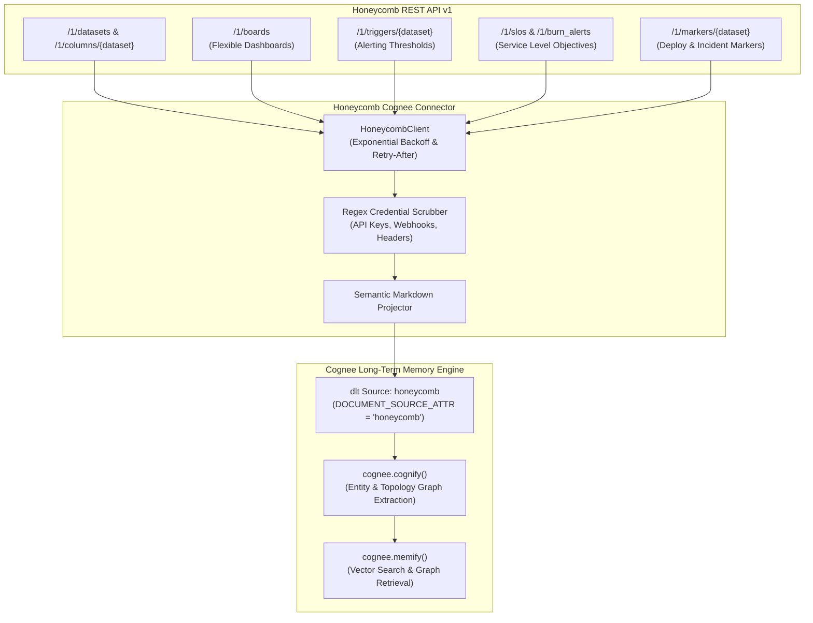

# Honeycomb Connector for Cognee

An open-source data-source connector that ingests Honeycomb telemetry datasets, schema columns, flexible boards, triggers, SLOs, and markers into Cognee cognitive memory graphs.

---

## Architecture Overview



---

## Features

- **Schema Mapping**: Ingests dataset schema definitions, column data types, descriptions, and visibility settings.
- **Boards & Queries**: Captures board configurations, panels, query annotations, and visualizations.
- **Alerting & SLOs**: Ingests threshold triggers, recipient channels (with webhook scrubbing), SLO target percentages, and burn alert schedules.
- **Deployment Markers**: Correlates deployments and incident markers with service health graphs.
- **Forget-on-Delete**: Configured with `write_disposition="replace"` so deleted SLOs or retired triggers are cleanly purged.
- **Rate-Limit Resilience**: Fully respects HTTP 429 `Retry-After` headers and applies exponential jittered backoff.

---

## Quickstart

```python
import asyncio
import os
import cognee
from cognee_community_connector_honeycomb import HoneycombConfig, honeycomb_source

async def main():
    config = HoneycombConfig(
        api_key=os.environ["HONEYCOMB_API_KEY"],
        dataset_slugs=["production-web", "checkout-service"],
        include_boards=True,
        include_triggers=True,
        include_slos=True,
        include_markers=True,
    )

    source = honeycomb_source(config=config)
    await cognee.remember(source, dataset_name="honeycomb_memory")

    results = await cognee.search(
        query_text="What are the SLO targets for checkout-service and did recent deploys affect them?",
        query_type=cognee.SearchType.GRAPH_COMPLETION,
        datasets=["honeycomb_memory"],
    )
    print(results)

if __name__ == "__main__":
    asyncio.run(main())
```

---

## Testing

Run the offline pytest suite:

```bash
pytest packages/connector/honeycomb/tests -v
```
