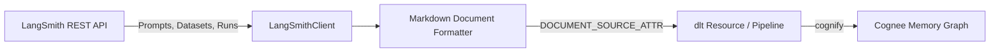

# Cognee LangSmith Data-Source Connector

A community data-source connector integrating **[LangSmith](https://smith.langchain.com)** with [Cognee](https://github.com/topoteretes/cognee)—the open-source memory layer for AI agents.

LangSmith is the enterprise platform for LLM evaluation, prompt management, and observability. This connector turns LangSmith prompt templates, evaluation datasets, and run feedback directly into cognee's graph memory so agents can query prompt histories, evaluation baselines, and quality metrics naturally.



## Features

- **Document-Mode Ingestion**: Declares `DOCUMENT_SOURCE_ATTR = "langsmith"` and `PIPELINE_SCOPE_ATTR`, indexing prompt templates, variable contracts, and evaluation benchmarks for contextual recall.
- **Deterministic Entity IDs**: Generates deterministic URIs (`langsmith:prompt:<handle>`, `langsmith:dataset:<id>`, `langsmith:run:<id>`) so re-syncs update existing graph nodes in place without entity duplication.
- **Incremental Sync**: Compares state hashes and `updated_at` timestamps in `dlt.current.resource_state()`, fetching details only for items that were modified since the last sync.
- **Forget-on-Delete**: Generates hard-delete `_deleted=True` tombstones under `write_disposition="merge"` with `columns={"_deleted": {"data_type": "bool", "hard_delete": True}}`, automatically removing deleted or deprecated prompts and benchmarks from memory via Cognee's `orphan_cleanup`.
- **Production Resilience**: Handles HTTP 429 rate limits honoring `Retry-After` headers, 5xx backoff retries, request budget safety caps, and secret redaction.

## Installation

```bash
pip install cognee-community-connector-langsmith
```

## Quick Start

```python
import asyncio
import os
import cognee
from cognee_community_connector_langsmith import langsmith_source

async def main():
    api_key = os.environ["LANGSMITH_API_KEY"]

    # Ingest prompt templates, evaluation datasets, and execution runs
    source = langsmith_source(
        api_key=api_key,
        resources=["prompts", "datasets", "runs"],
    )

    await cognee.remember(
        source,
        dataset_name="langsmith_metadata",
        primary_key="id",
        write_disposition="merge",
        max_rows_per_table=0,
    )

if __name__ == "__main__":
    asyncio.run(main())
```

## Testing

Run tests using `uv`:

```bash
cd packages/connector/langsmith
uv run pytest tests/
```
