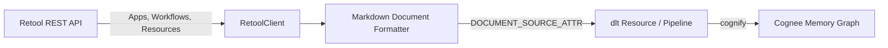

# Cognee Retool Data-Source Connector

A community data-source connector integrating **[Retool](https://retool.com)** with [Cognee](https://github.com/topoteretes/cognee)—the open-source memory layer for AI agents.

Retool is the industry-standard internal tool builder used across engineering, operations, and support organizations. This connector ingests internal app architectures, query designs, automation workflows, and connected data resource metadata directly into Cognee's entity extraction and knowledge graph memory layer.



## Features

- **Document-Mode Ingestion**: Declares `DOCUMENT_SOURCE_ATTR = "retool"`, indexing internal app interfaces, queries, triggers, and workflow blocks for contextual agent recall.
- **Security & Secret Redaction**: Embeds query logic and component summaries while strictly redacting database passwords, API keys, and raw canvas coordinate noise (`x, y, w, h`).
- **Deterministic Entity IDs**: Generates deterministic URIs (`retool:app:<id>`, `retool:workflow:<id>`, `retool:resource:<id>`) so re-syncs update existing graph nodes in place without entity duplication.
- **Incremental Sync**: Compares state hashes and `updatedAt` timestamps in `dlt.current.resource_state()`, fetching details only for items that were modified since the last sync.
- **Forget-on-Delete**: Generates hard-delete `_deleted=True` tombstones under `write_disposition="merge"`, automatically removing deleted or deprecated tools from memory via Cognee's `orphan_cleanup`.
- **Production Resilience**: Handles HTTP 429 rate limits honoring `Retry-After` headers, 5xx backoff retries, and request budget safety caps.

## Installation

```bash
pip install cognee-community-connector-retool
```

## Quick Start

```python
import asyncio
import os
import cognee
from cognee_community_connector_retool import retool_source

async def main():
    token = os.environ["RETOOL_API_KEY"]

    # Ingest apps, automation workflows, and resource metadata
    source = retool_source(
        token=token,
        resources=["apps", "workflows", "resources"],
    )

    await cognee.remember(
        source,
        dataset_name="retool_metadata",
        primary_key="id",
        write_disposition="merge",
        max_rows_per_table=0,
    )

if __name__ == "__main__":
    asyncio.run(main())
```

## Testing

Run tests using `uv`:

```bash
cd packages/connector/retool
uv run pytest tests/
```
