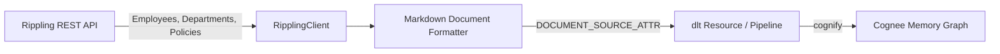

# Cognee Rippling Data-Source Connector

A community data-source connector integrating **[Rippling](https://rippling.com)** with [Cognee](https://github.com/topoteretes/cognee)—the open-source memory layer for AI agents.

Rippling is the workforce management platform that unifies HR, IT, and Finance operations. This connector ingests employee directory profiles, team hierarchies, and company policy documents directly into Cognee's entity extraction and knowledge graph memory layer, allowing AI agents to navigate organizational structure, identify department heads, and answer employee handbook policy questions accurately.



## Features

- **Document-Mode Ingestion**: Declares `DOCUMENT_SOURCE_ATTR = "rippling"` and `PIPELINE_SCOPE_ATTR`, indexing employee profiles, organizational departments, and company policies for semantic agent recall.
- **Privacy & PII Protection**: Indexes work profiles (roles, departments, managers, work emails) while strictly omitting sensitive personal identifying information (SSNs, banking details, personal phone numbers, and compensation).
- **Deterministic Entity IDs**: Generates deterministic URIs (`rippling:employee:<id>`, `rippling:department:<id>`, `rippling:policy:<id>`) so re-syncs update existing graph nodes in place without entity duplication.
- **Incremental Sync**: Compares state hashes and `updated_at` timestamps in `dlt.current.resource_state()`, fetching details only for items that were modified since the last sync.
- **Forget-on-Delete**: Generates hard-delete `_deleted=True` tombstones under `write_disposition="merge"` with `columns={"_deleted": {"data_type": "bool", "hard_delete": True}}`, automatically removing departed employees or deprecated policies from memory via Cognee's `orphan_cleanup`.
- **Production Resilience**: Handles HTTP 429 rate limits honoring `Retry-After` headers, 5xx backoff retries, request budget safety caps, and secret redaction.

## Installation

```bash
pip install cognee-community-connector-rippling
```

## Quick Start

```python
import asyncio
import os
import cognee
from cognee_community_connector_rippling import rippling_source

async def main():
    token = os.environ["RIPPLING_API_TOKEN"]

    # Ingest employees, organizational departments, and company policies
    source = rippling_source(
        api_token=token,
        resources=["employees", "departments", "policies"],
    )

    await cognee.remember(
        source,
        dataset_name="rippling_workforce",
        primary_key="id",
        write_disposition="merge",
        max_rows_per_table=0,
    )

if __name__ == "__main__":
    asyncio.run(main())
```

## Testing

Run tests using `uv`:

```bash
cd packages/connector/rippling
uv run pytest tests/
```
