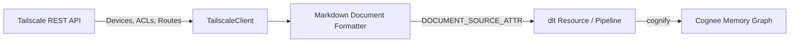

# Cognee Tailscale Data-Source Connector

A community data-source connector integrating **[Tailscale](https://tailscale.com)** with [Cognee](https://github.com/topoteretes/cognee)—the open-source memory layer for AI agents.

Tailscale is the zero-trust mesh overlay network built on WireGuard. This connector turns Tailnet devices/machines, ACL policies, security groups, and subnet route topology directly into Cognee's entity extraction and knowledge graph memory layer, allowing AI agents to query network architecture, identify subnet routers, inspect access policies, and audit machine inventory naturally.



## Features

- **Document-Mode Ingestion**: Declares `DOCUMENT_SOURCE_ATTR = "tailscale"` and `PIPELINE_SCOPE_ATTR`, indexing machines, security tags, ACL definitions, and subnet routes for semantic agent recall.
- **Deterministic Entity IDs**: Generates deterministic URIs (`tailscale:device:<id>`, `tailscale:acl:<tailnet>`, `tailscale:route:<id>`) so re-syncs update existing graph nodes in place without entity duplication.
- **Incremental Sync**: Compares state hashes and `last_seen` timestamps in `dlt.current.resource_state()`, fetching details only for items that were modified since the last sync.
- **Forget-on-Delete**: Generates hard-delete `_deleted=True` tombstones under `write_disposition="merge"` with `columns={"_deleted": {"data_type": "bool", "hard_delete": True}}`, automatically removing decommissioned machines and routes from memory via Cognee's `orphan_cleanup`.
- **Production Resilience**: Handles HTTP 429 rate limits honoring `Retry-After` headers, 5xx backoff retries, request budget safety caps, and secret redaction.

## Installation

```bash
pip install cognee-community-connector-tailscale
```

## Quick Start

```python
import asyncio
import os
import cognee
from cognee_community_connector_tailscale import tailscale_source

async def main():
    api_key = os.environ["TAILSCALE_API_KEY"]
    tailnet = os.environ.get("TAILSCALE_TAILNET", "-")

    # Ingest tailnet devices, ACL policies, and advertised routes
    source = tailscale_source(
        api_key=api_key,
        tailnet=tailnet,
        resources=["devices", "acls", "routes"],
    )

    await cognee.remember(
        source,
        dataset_name="tailscale_network",
        primary_key="id",
        write_disposition="merge",
        max_rows_per_table=0,
    )

if __name__ == "__main__":
    asyncio.run(main())
```

## Testing

Run tests using `uv`:

```bash
cd packages/connector/tailscale
uv run pytest tests/
```
