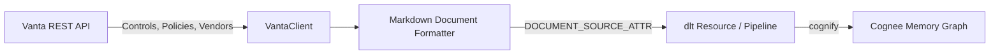

# Cognee Vanta Data-Source Connector

A community data-source connector integrating **[Vanta](https://vanta.com)** with [Cognee](https://github.com/topoteretes/cognee)—the open-source memory layer for AI agents.

Vanta is the industry-leading automated security and compliance platform across SOC 2, ISO 27001, HIPAA, and GDPR. This connector turns Vanta compliance controls, governance policies, and vendor risk assessments into Cognee's entity extraction and knowledge graph memory layer so AI agents can answer compliance audit questions, verify control implementation status, and monitor vendor security requirements automatically.



## Features

- **Document-Mode Ingestion**: Declares `DOCUMENT_SOURCE_ATTR = "vanta"` and `PIPELINE_SCOPE_ATTR`, indexing compliance controls, security policies, and vendor risk profiles for semantic agent recall.
- **Deterministic Entity IDs**: Generates deterministic URIs (`vanta:control:<id>`, `vanta:policy:<id>`, `vanta:vendor:<id>`) so re-syncs update existing graph nodes in place without entity duplication.
- **Incremental Sync**: Compares state hashes and `updated_at` timestamps in `dlt.current.resource_state()`, fetching details only for items that were modified since the last sync.
- **Forget-on-Delete**: Generates hard-delete `_deleted=True` tombstones under `write_disposition="merge"` with `columns={"_deleted": {"data_type": "bool", "hard_delete": True}}`, automatically removing deleted or deprecated compliance controls from memory via Cognee's `orphan_cleanup`.
- **Production Resilience**: Handles HTTP 429 rate limits honoring `Retry-After` headers, 5xx backoff retries, request budget safety caps, and secret redaction.

## Installation

```bash
pip install cognee-community-connector-vanta
```

## Quick Start

```python
import asyncio
import os
import cognee
from cognee_community_connector_vanta import vanta_source

async def main():
    token = os.environ["VANTA_API_TOKEN"]

    # Ingest compliance controls, governance policies, and vendor inventory
    source = vanta_source(
        api_token=token,
        resources=["controls", "policies", "vendors"],
    )

    await cognee.remember(
        source,
        dataset_name="vanta_compliance",
        primary_key="id",
        write_disposition="merge",
        max_rows_per_table=0,
    )

if __name__ == "__main__":
    asyncio.run(main())
```

## Testing

Run tests using `uv`:

```bash
cd packages/connector/vanta
uv run pytest tests/
```
